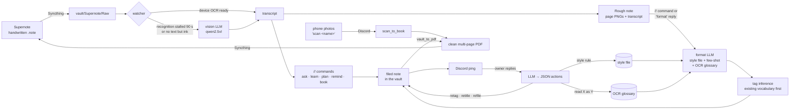

# supernote-agent

A local-LLM agent pipeline that turns handwriting on a Supernote e-ink tablet into filed, tagged Obsidian notes, and learns from your Discord replies how you want them.

**Status:** working and in daily use (systemd user services on one Linux desktop). Rough edges are listed under [Known issues](#known-issues); still to do are deskew/perspective correction for scans and flowing PDF annotations back into the vault.

<!-- MEDIA: side-by-side before/after. Left: a photo or screenshot of a handwritten page on the Supernote with dummy content (e.g. a short "Sourdough Starter" note with a `//tag as Cooking` line and a `//quiz 3` line). Right: the resulting note open in Obsidian (frontmatter properties visible, headings, highlighted key term, the Quiz block). Save as docs/media/before-after.png -->

<!-- MEDIA: screenshot of the Discord exchange for that note: the bot's "✅ Note: … 🏷️ Tags … 📁 Filed …" ping, your reply in plain English (e.g. "drop the cooking tag, call it Bread, and recipe notes should list ingredients first"), and the bot's ✅ reply summarising what it changed. Dummy content only. Save as docs/media/discord-feedback.png -->

## The self-improving loop

Most note pipelines are one-way. This one closes the loop:

1. **Feedback becomes style memory.** Every formatting prompt includes a plain-Markdown style file plus two random few-shot examples taken from your own well-formatted notes. Replying to a note's Discord ping with something like "recipe notes should list ingredients first" appends that rule to the style file, so every *future* note is formatted with it.
2. **An LLM turns replies into JSON actions.** A local model reads your free-text reply and returns a JSON object: `add_tags`, `del_tags`, `retitle`, `file_under`, `style_rules`, `memories`, `append`. The pipeline applies each action to the note, the style file or a memory file, then replies with what it did. If the model's output can't be parsed, a strict line grammar (`tag: X`, `retitle: Y`, `style: …`) takes over.
3. **It learns your handwriting.** "read p53 as PS3" adds an entry to an OCR-correction glossary. The glossary is fed to the formatter as *hints* (the entries that actually occur in the current text are ranked first), never as blind find-and-replace, so a wrong hint can't force a wrong change.
4. **Vision fallback.** When the tablet's own handwriting recognition hasn't finished by the time the file syncs (which in practice is most of the time), the page is rendered and read by a local vision model instead.



## What it does

- Watches the folder Syncthing syncs your Supernote notebooks into and processes each new or changed `.note`, including notebooks in subfolders.
- Always saves a readable "rough" copy: every inked page rendered to PNG, with the raw transcript in a collapsible callout. Nothing is lost if formatting or OCR goes wrong.
- Formats the transcript into clean Obsidian Markdown with a local LLM. This runs automatically when the note contains a `//` command; otherwise the bot asks on Discord and you reply **format** (or **y** / **n**).
- `//md` asks for a heavier restructure (headings, sections, real lists). If the model drops more than about 40% of the words, it falls back to the conservative formatter.
- Picks 2 to 4 tags, strongly preferring tags that already exist in the vault, and files the note by tag (routes are set in config). `//file under PATH` overrides the route.
- Handwritten commands: `//ask`, `//learn` (an explanation in your study style), `//plan` (milestones plus dated Obsidian Tasks checkboxes), `//remind@8:30 text` (plus `//summarize`, `//quiz 3` and `//recall` with an optional engine, see Known issues), formatting (`//h2`, `//todo`, `//math`…) and metadata (`//title is`, `//tag as`, `//link to`). Any other `//` line is sent to the LLM, which works out what was meant and routes it, so nothing you write is silently dropped.
- Re-syncs update the note in place. Everything above a `<!-- sn:end -->` marker belongs to the pipeline; anything you type below it in Obsidian survives every re-sync.
- Photos sent to the bot with the caption `scan <name>` are collected into a book and turned into one clean multi-page PDF that syncs back to the tablet, so you can write in it.
- Selected vault folders are mirrored back to the tablet as A5 PDFs (LaTeX rendered, callouts flattened, colour emoji replaced) for reading and annotating.
- A daily heartbeat checks the services, Syncthing devices and folders, notes that synced but were never processed, disk space and backup age, then posts one summary.
- `tools/supernote_screensaver.py`: a PyQt6 app that previews and dithers images to the Supernote's 1404×1872 e-ink screen and sends them as screensavers over USB or Wi-Fi.

## How it works

The interesting parts are the failure modes the tablet and the models threw up, and how each was beaten.

**The tablet syncs before it has read your handwriting.** The `.note` format records a per-page `RECOGNSTATUS`. Real recognition usually finishes *after* Syncthing has already copied the file, so waiting for it meant waiting forever. The watcher waits `SUPERNOTE_RECOGN_TIMEOUT` seconds (lowered from 300 to 90 once this was understood), then renders the page and asks a local vision model to transcribe it.

**Choosing the vision model by live testing on real handwriting.** `gemma4:26b` was accurate but needed about 20 GB, spilled to the CPU and took 2.5 to 5 minutes. `llava:7b` was fast but paraphrased and hallucinated, inventing whole sections and fake `//` lines, which is unacceptable for study notes. `qwen2.5vl:7b` captured both the prose and every command in about 17 s once warm. The first version also hung because generation had no `num_predict` cap and ran to the context limit.

**`//` almost never survives device OCR.** Captured device output read `//` as `I/`, `11`, `1/` or `l/` ("I/ recall", "11 recall division"), so the parser saw no commands at all. `canon_command_prefix()` rewrites a mangled prefix back to `//`, but conservatively: the remainder must start with a letter (so `1/2 cup` survives), and a prefix without a slash is promoted only when it is followed by a known command word (so `I/O ports` stays prose). This was built from the real captured strings after every engine was shown to work on clean input.

**Metadata lies about ink.** One note that "did nothing" was 230 KB, but its handwriting layer was 324 bytes. The size was all page template (graph paper), and the tablet had synced before flushing the strokes. The `TOTALPATH` metadata turned out to be wrong in both directions. Ink is now measured by rendering the handwriting layers with the template hidden and counting dark pixels. A genuinely empty sync gets a one-time ping ("close the notebook to flush the writing"), and a page that has ink but no recognised text (long division, diagrams) goes to the vision model instead of being dropped.

**Re-syncs that weren't changes.** When the tablet finished recognition minutes after a vision run, it re-saved the file: new bytes, the same handwriting, a slightly different OCR. The pipeline used to re-ping and overwrite a good note (with its Quiz block) with a worse device transcript. A no-op guard now compares normalised text with `difflib`: the same ink read by vision and by the device scored about 0.94, different notes about 0.27, so the threshold sits at 0.90.

**Formatting is opt-in for a reason.** The LLM turned spatial math such as long division into garbage, and not every note needs formatting. So the default became the rough copy (page images plus transcript), with formatting on request.

**Other bugs fixed along the way:** a give-up branch that wiped the sidecar's output link and so created dated duplicate notes (fixed at the source, with a backlink check in `_save_note` as a second guard); a systemd user service whose minimal `PATH` couldn't find the notification CLI, silently killing every ping; a boot-time DNS race (user services have no real `network-online.target`); a PDF mirror that regenerated an 826 KB PDF on every poll because sync kept touching a transcript's mtime (fixed with a source-size cap and a per-file cooldown); and, for scans, a phone sending one photo per message, which flooded Discord with acknowledgements until the bot learned to ack once per book.

**Scans stay gentle.** `scan_to_book` auto-orients, autocontrasts, lightly sharpens and caps the long edge at 2200 px. It deliberately doesn't binarise, so diagrams and grey shading survive. A book is built only after its newest photo is 90 s old, so a batch still arriving isn't cut in half. Only photos captioned `scan …` (or follow-up photos while a scan is open) become pages; a stray photo is left alone.

## Workflow for this project

- Built with a Cloud model, working against the live system: it ran every `//` command through the real parser and a live Ollama to prove the engines worked. That isolated "commands do nothing" to input fidelity, and the OCR-prefix normaliser was then written from the actual strings the device produced.
- Debugging by instrumenting the artefact rather than guessing: the "empty note" case was solved by rendering each layer of the `.note` separately (handwriting 324 bytes, template 227 KB), which led to the render-based ink check.
- Model choices were made by side-by-side runs on real handwriting, and the glossary was kept only after a before/after on real OCR: without it the note kept "p53" and "tt-a.gs"; with it they came out as "PS3" and "Tags".
- Split between agents: a coding agent builds the pipeline, while a local [Hermes Agent](https://github.com/NousResearch/hermes-agent) runs day to day as the operator on Discord. `skills/supernote-feedback/SKILL.md` is the operator-side skill for handling note feedback when the chat agent, rather than the feedback service, sees the reply.

## Requirements

- Linux with Python 3.11+ (uses `tomllib`) and systemd for the services
- [Ollama](https://ollama.com) with `qwen3:8b` and `qwen2.5vl:7b` (an 8 GB GPU is enough for the text model; the vision model also runs acceptably on the CPU)
- Syncthing syncing the tablet's note folder into `<vault>/Supernote/Raw`
- A Discord bot in a private channel (token, channel ID, your user ID)
- Python packages: `pip install -r requirements.txt` (`supernotelib`, Pillow, numpy, requests, bs4/lxml, markdown, matplotlib, WeasyPrint; PyQt6 for the screensaver tool)
- Optional: a SearXNG instance (web grounding for `//learn` and `//plan`), the Hermes Agent CLI (notifications and `//remind`'s cron), ImageMagick (cover photos, screensaver dithering)

## Install

```bash
git clone https://github.com/CipherNovaa/supernote-agent ~/supernote-agent
cd ~/supernote-agent
pip install --user -r requirements.txt

mkdir -p ~/.config/supernote-agent ~/.local/state/supernote-agent
cp config.example.toml ~/.config/supernote-agent/config.toml   # set vault.root and folders
cp .env.example        ~/.config/supernote-agent/.env          # bot token, channel, user id
chmod 600 ~/.config/supernote-agent/.env
cp style.example.md    ~/.local/state/supernote-agent/style.md

python3 src/sn_config.py      # self-test: prints every resolved path and what's missing

cp systemd/* ~/.config/systemd/user/   # adjust the repo path if it isn't ~/supernote-agent
systemctl --user daemon-reload
systemctl --user enable --now supernote-watcher supernote-feedback \
    pipeline-health.timer scan-inbox.timer
```

## Usage

- Write on the Supernote and let it sync. You'll get "📥 Got it" and then the result in Discord.
- Reply to a note's ping in plain English to retag, rename, refile, teach a style rule or add a thought; reply `read X as Y` to teach a handwriting correction.
- Send page photos to the bot with the caption `scan Chapter 3`; follow-up photos without a caption are added as pages.
- CLIs: `md_format.py [--rich] "text"`, `ocr_corrections.py list|add|prompt`, `learn_explain.py "topic"`, `idea_plan.py "goal"`, `scan_to_book.py "Title" img…`, `vault_to_pdf.py --dry-run`, `pipeline_health.py --quiet`.

## Layout

```
src/
  sn_config.py           paths, models, Discord creds (config.toml + env); notification sender
  supernote_watcher.py   the pipeline: OCR, vision fallback, rough/full notes, // commands,
                         tags, filing, LLM feedback → JSON actions, PDF mirror
  supernote_feedback.py  deterministic reply handler: style rules, tag edits, OCR
                         corrections, format y/n, scan-photo intake
  md_format.py           conservative and rich formatters (style file + few-shot + glossary)
  ocr_corrections.py     the learned handwriting glossary
  learn_explain.py       //learn engine      idea_plan.py   //plan engine
  reminder_set.py        //remind engine (scheduled through Hermes Agent's cron)
  scan_to_book.py        photos → PDF book
  vault_to_pdf.py        vault → A5 PDFs     pipeline_health.py  daily heartbeat
tools/supernote_screensaver.py   PyQt6 e-ink screensaver maker
skills/supernote-feedback/       Hermes Agent skill for the same feedback loop
systemd/                         user units and timers
examples/notes/                  invented few-shot examples
style.example.md                 the style-file format
```

## Known issues

- Two reply handlers run side by side: the watcher (LLM to JSON) and `supernote_feedback.py` (deterministic). A reply can be acted on by both.
- The watcher's LLM tag actions still edit a legacy `Tags:` body line, but notes now keep tags in frontmatter `topics:`. Tag edits through the deterministic handler work; through the LLM path they currently don't take effect.
- `//recall`, `//quiz` and `//summarize` call an optional `claude_powers` module that isn't included (it was tied to the author's vault layout). Until one is supplied, they report "unavailable".
- `//remind` needs the Hermes Agent CLI (`hermes cron`).

## Credits and licence

MIT © 2026 CipherNovaa, see [LICENSE](LICENSE).
Built on [supernotelib](https://github.com/jya-dev/supernote-tool) (Apache-2.0) for reading `.note` files, [Ollama](https://ollama.com) for local models, and optionally [Hermes Agent](https://github.com/NousResearch/hermes-agent) (MIT) for notifications, reminders and the chat-agent skill.
